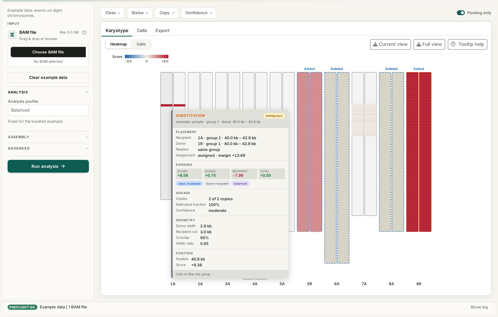
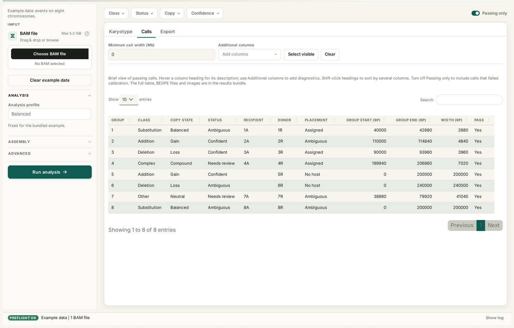
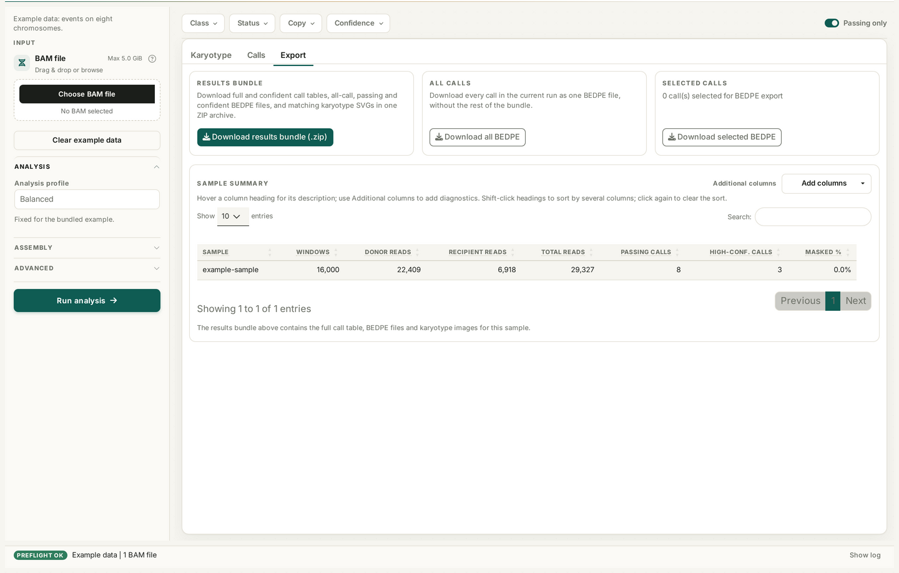

<p align="center">
  
</p>

<h1 align="center">MaMaMIA</h1>

<p align="center">
  <strong>Max Mapping for Meticulous Introgression Analysis</strong><br>
  Version 0.1.0 (first public release) · GPL (>= 3)
</p>

MaMaMIA is an interactive dashboard for detecting interspecific introgressions
from Genotyping-by-Sequencing (GBS) coverage. Upload a coordinate-sorted BAM,
select a donor and recipient species, run the analysis, and explore the results
as an interactive karyotype, sortable call table, and downloadable report
bundle. The method is ploidy-agnostic and supports any number of donor and
recipient components.

<p align="center">
  
</p>
<p align="center"><em>Interactive karyotype with per-call evidence and dosage. Screens use the bundled example data.</em></p>

## Highlights

- One BAM per run; multi-sample BAMs are read through their `@RG SM` tags.
- Donor and recipient species selected from a configurable registry.
- Vertical, group-aware karyotype with score-heatmap and call-map modes.
- Hover cards for class, status, placement, evidence, confidence, and dosage.
- Sortable, filterable call table and single-archive export bundle.
- Browser-side upload limit with [bamhusk](https://github.com/alermol/bamhusk)
  guidance for oversized BAMs.

## Workflow

1. **Upload a BAM.** Coordinate-sorted; the dashboard creates the CSI index.
   Oversized files can be slimmed with
   [bamhusk](https://github.com/alermol/bamhusk) first.
2. **Choose the species pair.** Select one donor and one recipient.
3. **Pick a profile.** Start with Balanced, or choose Sensitive, CNV-robust, or
   Complex. Advanced controls expose resolution, scoring, masking, and
   calibration.
4. **Run.** Follow stage-by-stage progress.
5. **Explore and export.** Inspect the karyotype and calls, then download the
   bundle.

## Analysis profiles

| Profile | Best for |
| --- | --- |
| Balanced | Default; normal or high coverage |
| Sensitive | Low coverage or subtle candidates |
| CNV-robust | Recipient copy-number variation |
| Complex | Multi-component donors |

## Interface

<p align="center">
  
</p>
<p align="center"><em>Sortable call table with configurable columns.</em></p>

<p align="center">
  
</p>
<p align="center"><em>Results bundle and sample summary.</em></p>

## Input requirements

- Coordinate-sorted BAM. SAM and CRAM are not accepted.
- One BAM per run; a multi-sample BAM is one file.
- The BAM must match the selected species assembly.
- The default upload limit is 5 GiB, configurable by the deployment.

## Oversized BAMs

If a BAM exceeds the dashboard upload limit, use
[bamhusk](https://github.com/alermol/bamhusk) locally before uploading. It
rewrites the BAM with the alignment fields MaMaMIA reads and removes base
qualities, read names, and optional tags; `--drop-seq` also removes the read
sequence while preserving read length through the CIGAR.

```sh
husk --drop-seq -@ 8 input.bam output.bam
```

Upload the resulting `output.bam` through the normal control.

## Export bundle

The **Export** tab downloads one ZIP archive with:

- full, passing, and confident call tables;
- BEDPE, BED, and bedGraph tracks;
- karyotype SVGs;
- per-window coverage, GC, MAPQ, score, and mask diagnostics;
- calibration thresholds and call summaries;
- QC plots and a self-contained `report.html`;
- provenance, session information, and checksums.

## Get started

Open the MaMaMIA dashboard provided by your deployment, upload a BAM, and
follow the workflow above. For container and server setup, see the
[deployment notes](docs-source/shinyproxy.md). The bundled **Example data**
button opens a complete tour without uploading a BAM.

## Documentation

Detailed configuration, method, result-field, and deployment guides live in the
[MaMaMIA wiki](https://github.com/alermol/MaMaMIA/wiki).

- [Karyotype tooltip guide](docs-source/karyotype-tooltip.md)

## License

GPL (>= 3). See [`LICENSE.md`](LICENSE.md).

## Contact

Aleksey Ermolaev <alerm@al-erm.ru> ·
[Issues](https://github.com/alermol/MaMaMIA/issues)
