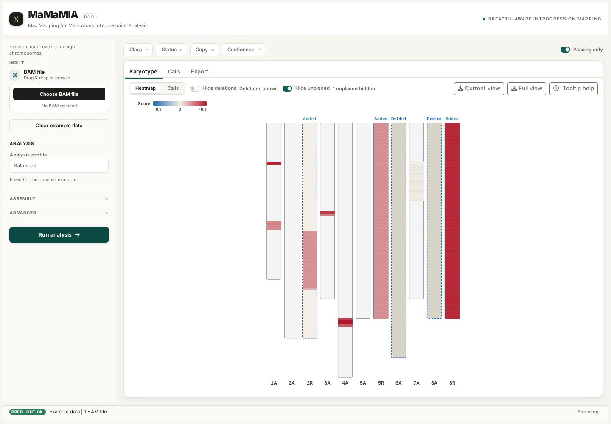

  

<h1 align="center">MaMaMIA</h1>

  <strong>Max Mapping for Meticulous Introgression Analysis</strong> 
  Version 0.1.0 · GPL (>= 3)

MaMaMIA is a self-hosted Shiny web service for detecting interspecific
introgressions from Genotyping-by-Sequencing (GBS) coverage. Upload a
coordinate-sorted BAM, choose a donor and recipient species, run the analysis,
and explore the results as an interactive karyotype, sortable call table, and
downloadable report bundle. The method is ploidy-agnostic and supports any
number of donor and recipient components.

*The Karyotype tab after the bundled example run. Hide deletions and Hide
unplaced are on by default; the call table follows the rendered karyotype.*

The supported deployment is the Docker image under ShinyProxy, or the same
image run directly.

## What you get

The karyotype draws one bar per chromosome and tracks deleted recipients,
added donors, and neutral unplaced donors as separate states. Hide deletions
removes deletion evidence from the current view. Hide unplaced hides only calls
that cannot be placed anywhere, so donor-only additions stay visible. Each
control has a counter beside it.

The Calls tab mirrors that view instead of keeping its own wider filtered
table. Result bundles contain current, full, confident, and actual-view
karyotype SVGs. Downloads with the same view reuse a cached archive.

## Quick start

1. Open the MaMaMIA dashboard provided by your deployment.
2. Upload a BAM, or choose **Example data** for a guided tour.
3. Select the recipient and donor species.
4. Pick an analysis profile and press **Run analysis**.
5. Explore **Karyotype** and **Calls**, then download the result bundle from
   **Export**. The bundle contains the active view, all calls, confident calls,
   and an actual-view SVG with deletions removed.

For BAMs above the deployment upload limit, slim them locally with
[bamhusk](https://github.com/alermol/bamhusk) before uploading.

## Documentation

Detailed guides, screenshots, configuration, method, and deployment notes live
in the [MaMaMIA wiki](https://github.com/alermol/MaMaMIA/wiki).

| Guide | Contents |
| --- | --- |
| [Getting Started](https://github.com/alermol/MaMaMIA/wiki/Getting-Started) | First run, Docker, and source checkout |
| [Dashboard Guide](https://github.com/alermol/MaMaMIA/wiki/Dashboard-Guide) | Every control, filter, tab, and download |
| [Inputs and Assemblies](https://github.com/alermol/MaMaMIA/wiki/Inputs-and-Assemblies) | BAM requirements, bamhusk, registry, components, and pairing |
| [Analysis Profiles](https://github.com/alermol/MaMaMIA/wiki/Analysis-Profiles) | Balanced, Sensitive, CNV robust, Complex, and Custom |
| [Method](https://github.com/alermol/MaMaMIA/wiki/Method) | Windows, scoring, masks, CBS, calibration, and placement |
| [Results and Calls](https://github.com/alermol/MaMaMIA/wiki/Results-and-Calls) | Reading classes, status, placement, and rendering |
| [Call Fields](https://github.com/alermol/MaMaMIA/wiki/Call-Fields) | Every call column and its bundle name |
| [Karyotype](https://github.com/alermol/MaMaMIA/wiki/Karyotype) | Plot modes, chromosome states, hide switches, and SVG export |
| [Karyotype Tooltips](https://github.com/alermol/MaMaMIA/wiki/Karyotype-Tooltips) | The complete call-card and chromosome-card field guide |
| [Export Bundle](https://github.com/alermol/MaMaMIA/wiki/Export-Bundle) | Files, formats, QC, and reproducibility |
| [Configuration Reference](https://github.com/alermol/MaMaMIA/wiki/Configuration-Reference) | Complete registry schema and defaults |
| [Deployment](https://github.com/alermol/MaMaMIA/wiki/Deployment) | Docker, ShinyProxy, direct port, mounts, and security |
| [Validation](https://github.com/alermol/MaMaMIA/wiki/Validation) | Real-data evidence and limitations |
| [Troubleshooting](https://github.com/alermol/MaMaMIA/wiki/Troubleshooting) | Common failures and fixes |
| [Development](https://github.com/alermol/MaMaMIA/wiki/Development) | Repository layout, module map, tests, and release checks |
| [Glossary](https://github.com/alermol/MaMaMIA/wiki/Glossary) | Terms used throughout the documentation |

## License

GPL (>= 3). See [`LICENSE.md`](LICENSE.md).

## Contact

Aleksey Ermolaev <alerm@al-erm.ru> ·
[Issues](https://github.com/alermol/MaMaMIA/issues)
